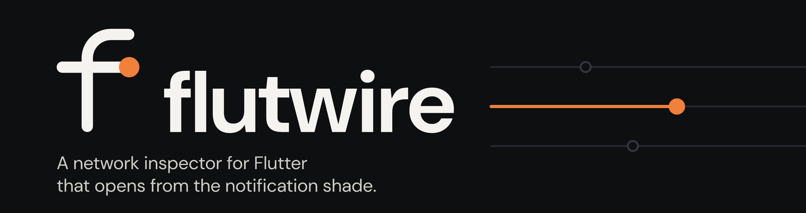
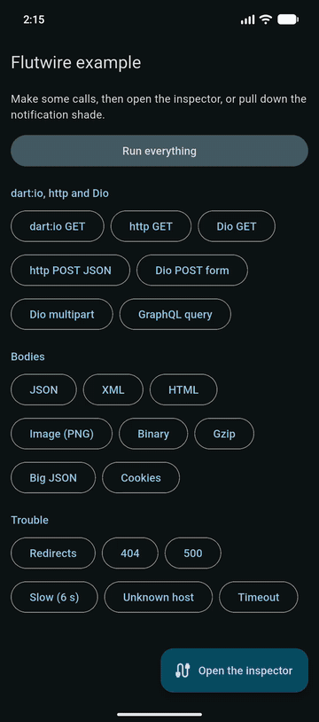
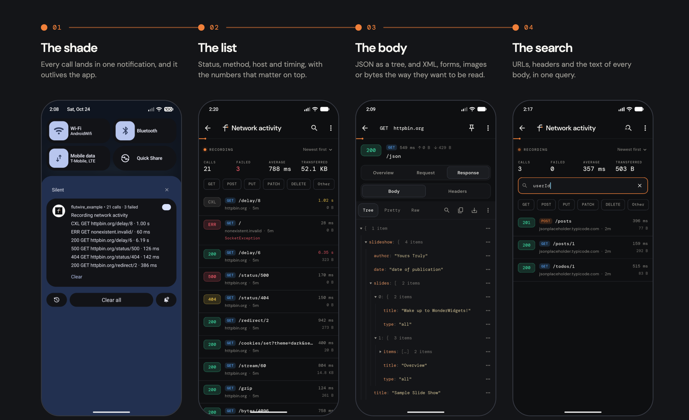
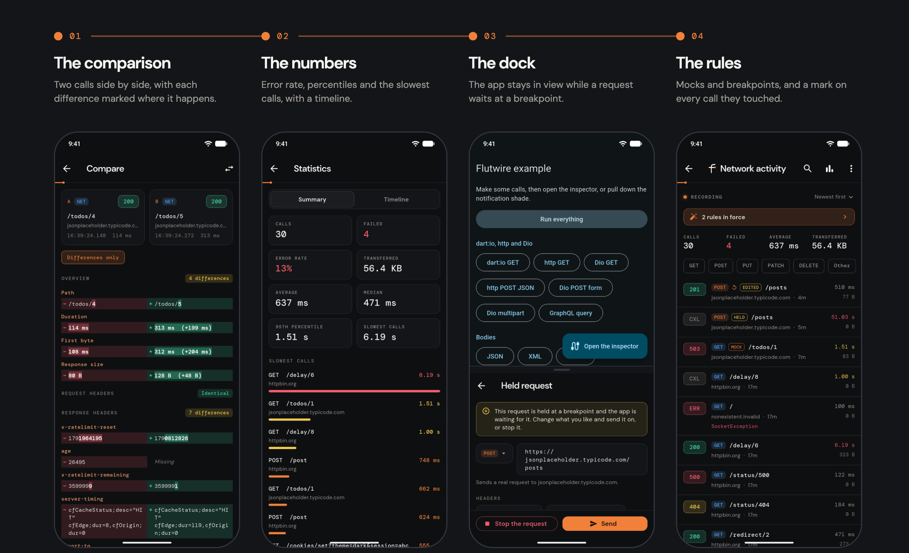
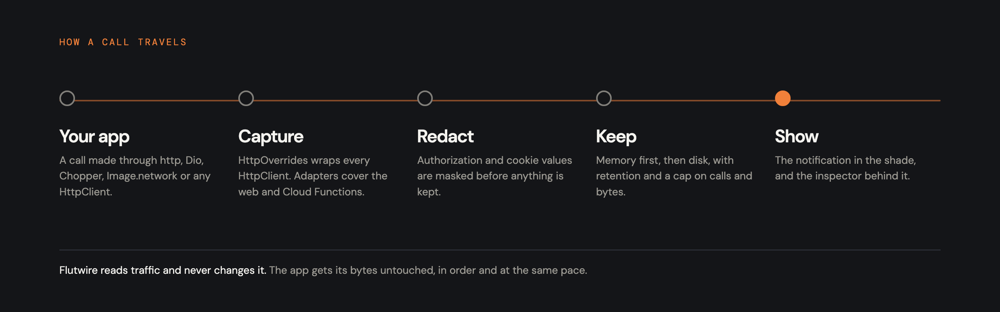

<p align="center">
  
</p>

# Flutwire

**A network inspector for Flutter that opens from the notification shade.**

[](https://github.com/NaCode-Studios/Flutwire/actions/workflows/ci.yaml)
[](https://pub.dev/packages/flutwire)
[](https://pub.dev/packages/flutwire/score)
[](LICENSE)

When an app misbehaves on a phone, the call that explains it is usually out of reach. The console shows only what a logger was told to print. A proxy needs a certificate on the device and a changed Wi-Fi setting. Every HTTP client in the app has to be wired by hand before it says anything, and when the app is killed the evidence goes with it.

Flutwire records the calls an app makes, keeps them on the device and lists the latest ones in the notification shade. Tapping it opens the inspector, and each call opens in full: URL, timings, headers, cookies, and the request and response bodies as a JSON tree, indented text, form fields, an image or a hex dump. A call can be edited and sent again from the same screen, and a WebSocket or an event stream lists its messages as they arrive. A debug build needs one line in `main`; a release build records nothing.

<p align="center">
  <a href="docs/media/flutwire-demo.mp4"></a><br>
  <sub><a href="docs/media/flutwire-demo.mp4">Watch the whole tour</a>, 40 seconds on an Android emulator.</sub>
</p>

```bash
flutter pub add flutwire
```

```dart
Future<void> main() async {
  await Flutwire.init();
  runApp(const MyApp());
}
```

From then on every call that goes through `dart:io` is recorded: `package:http`, Dio's default adapter, Chopper, `Image.network`, anything that ends in an `HttpClient`. Three small packages cover what `dart:io` does not reach.

```dart
dio.interceptors.add(FlutwireDioInterceptor());   // flutwire_dio, for the web
final client = FlutwireClient(http.Client());     // flutwire_http, for the web
FlutwireCloudFunctions.install();                 // flutwire_cloud_functions, after Firebase.initializeApp
MaterialApp(builder: Flutwire.builder);           // a button where there is no notification
```

<p align="center">
  <picture>
    <source media="(prefers-color-scheme: light)" srcset="docs/media/flutwire-tour-light.png">
    
  </picture>
</p>

The inspector also sets two calls side by side, adds up the numbers of a history and sits in a panel beside the app. With interception turned on, a rule answers a request with a mock or holds it at a breakpoint.

<p align="center">
  <picture>
    <source media="(prefers-color-scheme: light)" srcset="docs/media/flutwire-beyond-light.png">
    
  </picture><br>
  <sub><a href="docs/media/flutwire-beyond.mp4">Watch it work</a>, 74 seconds on an Android emulator.</sub>
</p>

This is what the notification lists, and what a call becomes when it is shared as a command:

```text
201 POST api.example.com/v1/orders · 148 ms
404 GET api.example.com/v1/clubs/9 · 96 ms
ERR GET api.example.com/health
```

```bash
curl -X POST 'https://api.example.com/v1/orders' \
  -H 'content-type: application/json' \
  -H 'authorization: [redacted]' \
  --data-raw '{"items":[{"sku":"A-12","qty":2}]}'
```

Flutwire reads traffic and changes it only through the mocks and breakpoints the app turns on. It does not proxy other apps, and it cannot see what never passes through Dart: Firestore, Auth and Storage speak their own protocols through native SDKs. When a call may have gone unseen, because a client does not use `dart:io`, because an adapter ran in an isolate that never attached to Flutwire or because something replaced the capture, the inspector says so above the list and says what to change. Authorization and cookie values are masked when a call is recorded, so they never reach memory, disk, a notification or an export. The only requests Flutwire makes itself are the ones you edit and send again, from a recorded call or from a breakpoint, and a call sent again leaves out any value that was masked.

In a release build `Flutwire.init` does nothing: no call is recorded, no file is written and no notification is posted. The plugin's native code still ships in the app, like any other plugin's, and stays idle until Flutwire starts: on iOS and macOS it leaves the app's notification delegate alone, and on Android its manifest adds the notification permission to the merged one.

> **Status — `1.0`, stable.** The public API follows [Semantic Versioning](STABILITY.md): a breaking change needs a new major version, and a deprecated member stays for at least two minor releases. The plan is on [the project board](https://github.com/orgs/NaCode-Studios/projects/13).

## Why Flutwire

**It needs no wiring.** One `await Flutwire.init()` records every call that goes through `dart:io`, including the ones made by packages you did not write. There is no interceptor to add to each client and no certificate to install. The test suite makes calls with `http`, Dio and a raw `HttpClient` and checks that each one is recorded with no per-client setup.

**The history outlives the app.** A call is written to disk as soon as it ends, and the notification survives the process. Kill the app, tap the notification and the inspector opens on the calls read back from disk. Retention runs from one hour to forever, a cap on the number of calls and on bytes keeps the folder small, and a pinned call is never removed.

**It searches the payloads, not only the URLs.** The list search looks at URLs, status codes, GraphQL operation names, headers and the text of request and response bodies, so finding where an id came from is one query. Inside a body, search highlights every match and jumps between them.

**It sees what `dart:io` cannot.** Firebase callable functions travel through the native SDK, so no HTTP-level capture sees them. `flutwire_cloud_functions` sits on the Dart side of the `cloud_functions` plugin and records each callable, by name or by URL, with its payload, its result or error code and how long it took. The app's code does not change.

## Architecture

<p align="center">
  <picture>
    <source media="(prefers-color-scheme: light)" srcset="docs/media/flutwire-flow-light.png">
    
  </picture>
</p>

```text
Flutwire
├── packages/flutwire                 the package
│   ├── lib/src/capture               the HttpClient wrapper, the recorder, redaction
│   ├── lib/src/model                 a call, its bodies, headers, cookies, multipart parts
│   ├── lib/src/store                 the history in memory and on disk, and preferences
│   ├── lib/src/export                cURL, HAR 1.2, text and JSON
│   ├── lib/src/decode                Protobuf and MessagePack bodies
│   ├── lib/src/compare               the line diff and the comparison of two calls
│   ├── lib/src/stats                 the numbers of a history and its timeline
│   ├── lib/src/intercept             the rules that answer or hold a request, and what is held
│   ├── lib/src/notify                what the notification says and when it changes
│   ├── lib/src/ui                    the inspector, the body viewer, settings
│   ├── android, darwin               the native halves
│   └── example                       an app that makes every kind of call
├── packages/flutwire_dio             a Dio interceptor
├── packages/flutwire_http            a package:http client
├── packages/flutwire_cloud_functions Firebase callable functions
└── docs/brand                        the brand kit
```

| Component | What it does |
| --- | --- |
| Capture | Wraps `HttpClient` through `HttpOverrides`, copies the byte streams as they pass and hands the copies to the recorder. Unless the app turns interception on, it gets its bytes untouched, in order and at the same pace. |
| Model | A call with its bodies cut at a limit that keeps the real size, GraphQL operation names, and the redaction policy. |
| Store | The history in memory and on disk with retention and limits, and what the user picked in the settings. |
| Export | A call or many as cURL, HAR 1.2, text or JSON, and a body as a file. |
| Interception | Rules that answer a request with a stored response or hold it until somebody has looked at it. Off until the app asks for it. |
| Notify | Decides what the notification lists and when it updates. The native halves only relay. |
| Inspector | The list, the call in full, the body viewer, two calls side by side, statistics, a dock beside the app and the settings, in dark and light, in English and Italian. |
| Adapters | The Dio interceptor, the `http` client and the Cloud Functions recorder, for the places `dart:io` does not reach. |

## Roadmap

**Shipped (`1.0.2`).** A notification that is not Flutwire's no longer closes an app that also has Firebase Messaging on iOS and macOS, because the plugin now keeps every delegate it replaces instead of one. [`CHANGELOG.md`](CHANGELOG.md) has the detail.

**Shipped (`1.0.1`).** A call whose answer has no body now ends when its head arrives, and the pulse of the inspector beats a few times and stops, so that an inspector left open no longer keeps the app drawing. [`CHANGELOG.md`](CHANGELOG.md) has the detail.

**Shipped (`1.0.0`).** A review of the public API, so that every export names what it makes public and the types that were never meant to be implemented are closed to it, a written [stability policy](STABILITY.md) with its deprecation window, a layout number on the history kept on disk, and a Protobuf decoder checked against what `protoc` writes. [`CHANGELOG.md`](CHANGELOG.md) has the detail.

**Shipped (`0.2.0`).** Editing a call and sending it again, the messages of a WebSocket and of an event stream, comparing two calls, statistics and a timeline, a dock beside the app, mocks and breakpoints, calls made in other isolates, Protobuf and MessagePack bodies, and a note above the list when calls may have gone unseen. [`CHANGELOG.md`](CHANGELOG.md) has the detail.

**Shipped (`0.1.0`).** Capture, the history on disk, the notification on Android, iOS and macOS, the inspector with the body viewer, export, the adapters and the example app.

**Next.** gRPC capture. gRPC in Dart opens its own sockets, so the `HttpClient` wrapper cannot see it, and it needs an interceptor for the `grpc` package. It has no date yet. The ideas that were turned down, with the reason, are on the board too.

The plan lives on [the project board](https://github.com/orgs/NaCode-Studios/projects/13) and is mirrored as [milestones](https://github.com/NaCode-Studios/Flutwire/milestones).

## Building and testing

```bash
flutter pub get
```

```bash
flutter analyze --fatal-infos
```

Each package has its own suite: run `flutter test` inside `packages/flutwire`, `packages/flutwire_dio`, `packages/flutwire_http` and `packages/flutwire_cloud_functions`.

The Android and Apple halves are compiled by building the example app from `packages/flutwire/example`: `flutter build apk --debug`, `flutter build ios --simulator --no-codesign` and `flutter build macos --debug`.

## Contributing

Read [CONTRIBUTING.md](CONTRIBUTING.md) first. For anything larger than a fix, open an issue so the shape is agreed before the code is written.

## License

Apache-2.0, in [LICENSE](LICENSE).

## Sponsor

Flutwire is built by NaCode Studios. If it is useful to you, you can [sponsor the studio](https://github.com/sponsors/NaCode-Studios).
